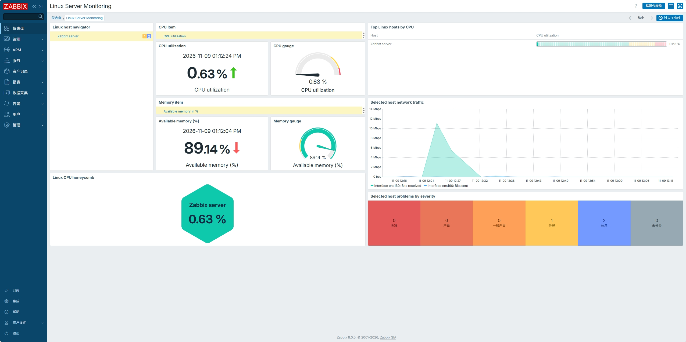
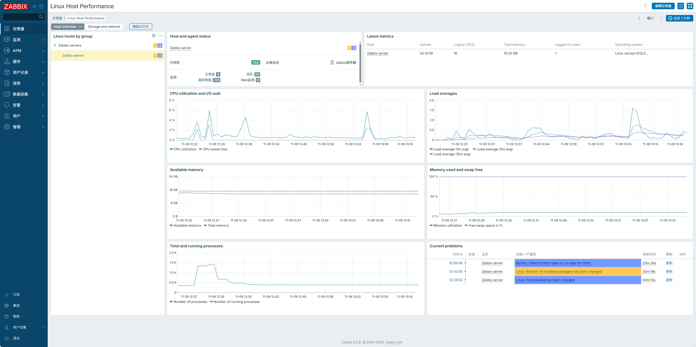
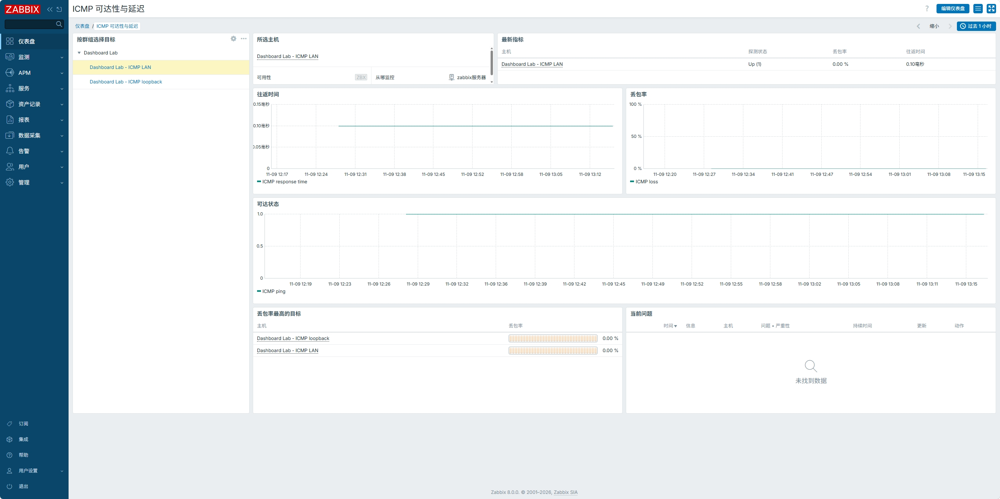
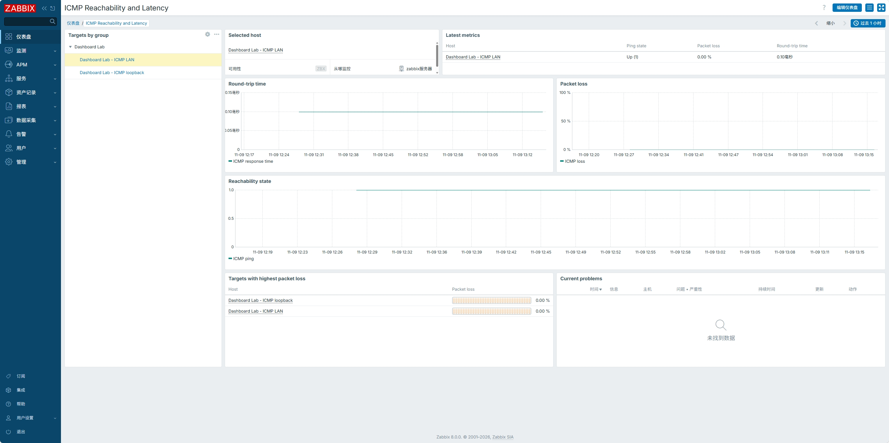
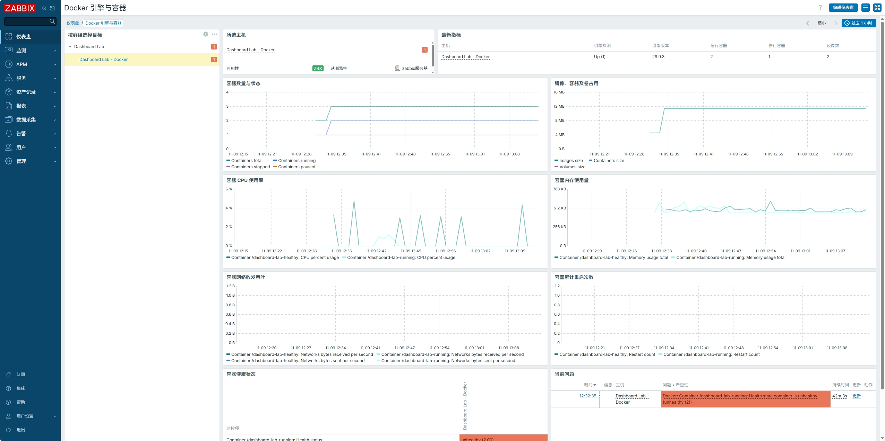

# Zabbix 8.0 仪表盘模板

**简体中文** · [English](README_en.md)

本项目提供 13 套可导入的 Zabbix 8.0 全局仪表盘。每套均有简体中文和英文源文件，可按需导入，也可同时导入两个版本。

## 导入与使用

1. 在 Zabbix 打开 **仪表盘 → 所有仪表盘 → 导入**，选择下方对应语言的源文件。首次导入启用**创建缺失**。重新导入时，启用**更新现有**会替换同名仪表盘的页面和组件。
2. 为监控目标关联对应的监控模板，并确认主机标签及采集状态。文件系统、端口、容器等图表需要相应的自动发现监控项和历史数据。
3. 打开仪表盘，在各页签左侧选择主机或目标。通过右上角的时间选择器调整趋势图范围。自定义标题随导入版本显示，系统菜单和告警级别随用户界面语言显示。

## 模板介绍

### 1. Linux 服务器监控

适合日常巡检。交互式概览随所选主机显示处理器使用率、可用内存、网卡流量和告警级别分布。蜂窝图和处理器排行用于对照多台主机。

关联 Linux 系统监控模板，主机标签为 `target=linux`。网卡曲线依赖接口自动发现。

[简体中文源文件](zh-CN/linux-server-monitoring.zh-CN.yaml) · [英文源文件](en/linux-server-monitoring.en.yaml)

### 2. Linux 主机性能分析

适合排查单台主机的性能瓶颈。主机概览页显示系统负载、处理器与输入输出等待、内存、交换空间和进程。存储与网络页显示挂载点容量、空闲索引节点、磁盘吞吐与等待时间，以及网卡流量、错误和丢弃包。

关联 Linux 系统监控模板，主机标签为 `target=linux`。存储与网络页需要相应的自动发现数据。

[简体中文源文件](zh-CN/linux-host-performance.zh-CN.yaml) · [英文源文件](en/linux-host-performance.en.yaml)

### 3. Zabbix 服务端全景状态

平台健康页显示当前实例的系统信息，以及所选主机的采集速率、数据库写入速率、队列、进程繁忙率和缓存使用率。服务器资源页显示处理器、内存、负载、文件系统、磁盘与网卡。

主机标签为 `target=zabbix`。平台健康页依赖 Zabbix 服务端健康模板，服务器资源页依赖 Linux 系统监控模板。

[简体中文源文件](zh-CN/zabbix-server-status.zh-CN.yaml) · [英文源文件](en/zabbix-server-status.en.yaml)

### 4. Windows 系统监控

系统与计算页显示采集代理可用性、处理器时间分布与队列、内存、分页文件、进程和线程。存储与网络页显示卷空间、磁盘请求等待、网卡流量和错误。

关联 Windows 系统监控模板，主机标签为 `target=windows`。卷、磁盘和网卡指标依赖自动发现。

[简体中文源文件](zh-CN/windows-system.zh-CN.yaml) · [英文源文件](en/windows-system.en.yaml)

### 5. SNMP 网络设备与端口

查看设备可用性、运行时长和端口状态，通过收发流量、错误包和丢弃包定位异常端口。页面还显示探测往返时间和丢包率。

关联通用 SNMP 网络设备模板，主机标签为 `target=generic`，并配置 SNMP 接口及端口自动发现。

[简体中文源文件](zh-CN/snmp-network-device.zh-CN.yaml) · [英文源文件](en/snmp-network-device.en.yaml)

### 6. ICMP 可达性与延迟

查看所选目标的可达状态、往返时间和丢包率趋势。丢包排行用于比较当前用户有权限查看的匹配目标。

关联 ICMP 探测模板，主机标签为 `target=icmp`，并配置可探测的目标地址。

[简体中文源文件](zh-CN/icmp-reachability.zh-CN.yaml) · [英文源文件](en/icmp-reachability.en.yaml)

### 7. 网站浏览器性能

将页面加载时间拆分为域名解析、连接、加密握手、请求、响应和文档就绪等阶段，同时显示传输大小与正文大小。

关联网站浏览器监控模板，主机标签为 `target=browser`。需要可用的浏览器驱动及已配置的网站地址。

[简体中文源文件](zh-CN/website-browser-performance.zh-CN.yaml) · [英文源文件](en/website-browser-performance.en.yaml)

### 8. TLS 证书有效期

按到期时间查找最早到期的证书，并查看所选主机的证书校验结果、生效时间和签名算法。

关联网站证书监控模板，主机标签为 `target=certificate`。需要通过 Zabbix 采集代理 2 获取证书，并完成证书发现。

[简体中文源文件](zh-CN/tls-certificate-inventory.zh-CN.yaml) · [英文源文件](en/tls-certificate-inventory.en.yaml)

### 9. MySQL 性能与复制

负载与连接页显示查询速率、连接线程、慢查询和网络吞吐。InnoDB 与复制页显示缓冲池效率、行锁等待、库容量和复制延迟。

关联基于 Zabbix 采集代理 2 的 MySQL 模板，主机标签为 `target=mysql`。库容量依赖数据库发现，复制延迟应在副本上查看。

[简体中文源文件](zh-CN/mysql-operations.zh-CN.yaml) · [英文源文件](en/mysql-operations.en.yaml)

### 10. PostgreSQL 性能与复制

会话与事务页显示连接状态、提交与回滚速率、缓存命中率、死锁和冲突。容量与复制页显示各库容量、锁数量、复制延迟及字节差。

关联基于 Zabbix 采集代理 2 的 PostgreSQL 模板，主机标签为 `target=postgresql`。分库和分应用指标依赖相应发现规则。

[简体中文源文件](zh-CN/postgresql-operations.zh-CN.yaml) · [英文源文件](en/postgresql-operations.en.yaml)

### 11. Redis 缓存与持久化

查看客户端连接与阻塞、内存与常驻集、网络吞吐、命中和未命中累计值，以及键的过期、淘汰与各逻辑库键数。页面也显示最近一次持久化操作耗时。

关联基于 Zabbix 采集代理 2 的 Redis 模板，主机标签为 `target=redis`。逻辑库键数依赖数据库发现。

[简体中文源文件](zh-CN/redis-operations.zh-CN.yaml) · [英文源文件](en/redis-operations.en.yaml)

### 12. Docker 引擎与容器

查看引擎状态、容器数量、镜像与卷占用。按容器查看处理器、内存、网络、累计重启次数和健康状态。

关联基于 Zabbix 采集代理 2 的 Docker 模板，主机标签为 `target=docker`。采集端需要访问 Docker 接口并启用容器发现。

[简体中文源文件](zh-CN/docker-runtime.zh-CN.yaml) · [英文源文件](en/docker-runtime.en.yaml)

### 13. VMware vSphere 主机与虚拟机

ESXi 主机页显示处理器、内存、网络和数据存储延迟。虚拟机页显示处理器调度等待、来宾与宿主内存、虚拟磁盘延迟和来宾文件系统空间。

关联 VMware 宿主机和来宾机监控模板。宿主机使用 `target=vmware-hypervisor`，虚拟机使用 `target=vmware-guest`。

[简体中文源文件](zh-CN/vmware-vsphere.zh-CN.yaml) · [英文源文件](en/vmware-vsphere.en.yaml)

## 验证情况

26 个语言版本共 38 个页面已在 Zabbix 8.0.0 完成前端数据验证。Linux、Zabbix 服务端、网络探测、网站、证书、数据库和容器使用实际采集数据。MySQL 使用 MariaDB 主从验证，Redis 使用兼容 Redis 协议的 Valkey 验证。Windows 和 VMware vSphere 使用明确标注的模拟目标验证。
