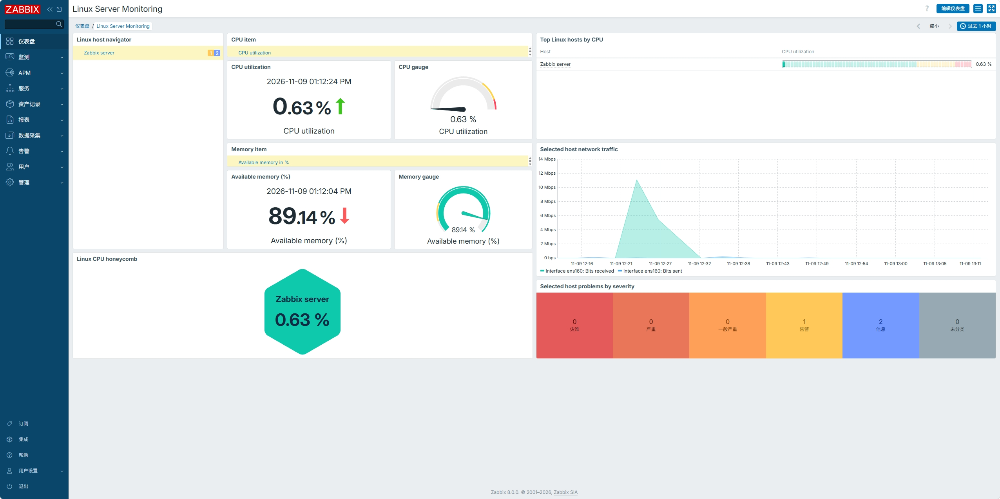
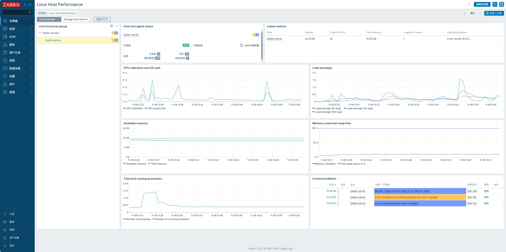
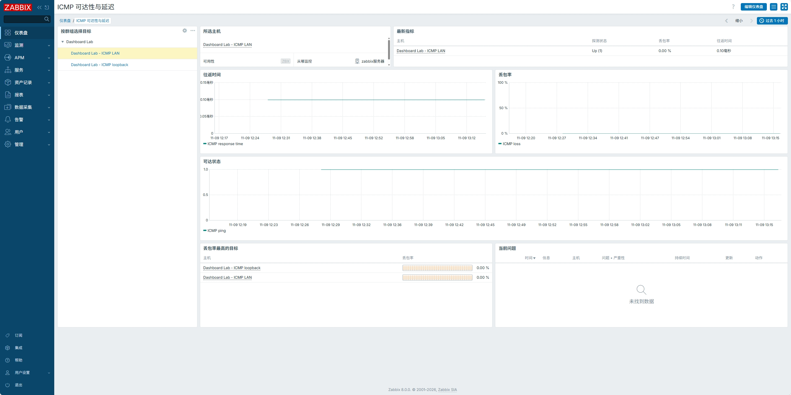
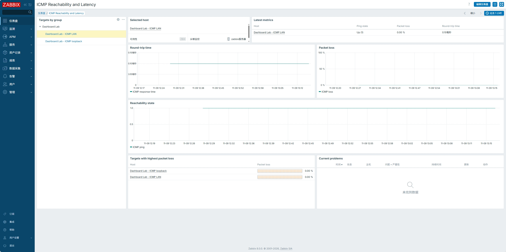
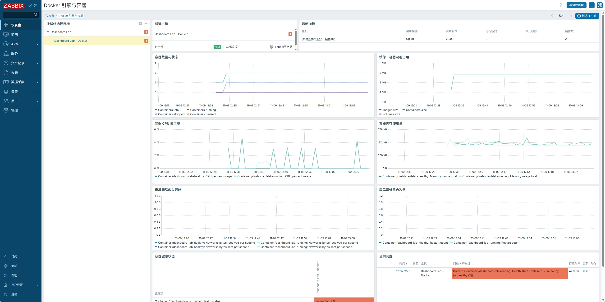

# Zabbix 8.0 Dashboard Templates

[简体中文](README.md) · **English**

This project provides 23 importable global dashboards for Zabbix 8.0. Each dashboard has Simplified Chinese and English source files. You can import either version or both.

## Import and use

1. In Zabbix, go to **Dashboards → All dashboards → Import** and select the source file for your preferred language. Enable **Create missing** on the first import. On subsequent imports, enabling **Update existing** replaces the pages and widgets of a dashboard with the same name.
2. Link the appropriate monitoring template to the target and verify its host tags and data collection status. File system, port, and container charts require the corresponding discovered items and historical data.
3. Open the dashboard and select a host or target on the left of each tab. Use the time selector in the upper-right corner to adjust the chart range. Custom titles use the language of the imported version. System menus and problem severity labels use your Zabbix interface language.

## Dashboards

### 1. Linux Server Monitoring

Designed for routine checks. The interactive overview shows CPU utilization, available memory, network interface traffic, and problem severity for the selected host. Use the honeycomb and CPU ranking to compare hosts.

Link the Linux monitoring template and use the `target=linux` host tag. Traffic charts require network interface discovery.

[Simplified Chinese source](zh-CN/linux-server-monitoring.zh-CN.yaml) · [English source](en/linux-server-monitoring.en.yaml)

### 2. Linux Host Performance

Use this dashboard to troubleshoot performance on an individual host. Host Overview shows system load, CPU utilization and I/O wait, memory, swap, and processes. Storage and Network shows mount point capacity, free inodes, disk throughput and latency, and network traffic, errors, and dropped packets.

Link the Linux monitoring template and use the `target=linux` host tag. Storage and Network requires the corresponding discovery data.

[Simplified Chinese source](zh-CN/linux-host-performance.zh-CN.yaml) · [English source](en/linux-host-performance.en.yaml)

### 3. Zabbix Server Status

Platform Health shows information about the current Zabbix instance and the selected host's collection rate, database write rate, queues, process busy time, and cache usage. Server Resources shows CPU, memory, system load, file systems, disks, and network interfaces.

Use the `target=zabbix` host tag. Platform Health requires the Zabbix server health template. Server Resources requires the Linux monitoring template.

[Simplified Chinese source](zh-CN/zabbix-server-status.zh-CN.yaml) · [English source](en/zabbix-server-status.en.yaml)

### 4. Windows System Monitoring

System and Compute shows agent availability, CPU time by category, the CPU queue, memory, page file usage, processes, and threads. Storage and Network shows volume usage, disk request latency, network traffic, and errors.

Link the Windows monitoring template and use the `target=windows` host tag. Volume, disk, and network metrics require discovery.

[Simplified Chinese source](zh-CN/windows-system.zh-CN.yaml) · [English source](en/windows-system.en.yaml)

### 5. SNMP Network Devices and Ports

Check device availability, uptime, and port status. Use inbound and outbound traffic, errors, and discards to identify problematic ports. The dashboard also shows probe round-trip time and packet loss.

Link the generic SNMP network device template, use the `target=generic` host tag, and configure an SNMP interface and port discovery.

[Simplified Chinese source](zh-CN/snmp-network-device.zh-CN.yaml) · [English source](en/snmp-network-device.en.yaml)

### 6. ICMP Reachability and Latency

Track reachability, round-trip time, and packet loss for the selected target. The packet loss ranking compares matching targets visible to the current user.

Link the ICMP probe template, use the `target=icmp` host tag, and configure a reachable probe target address.

[Simplified Chinese source](zh-CN/icmp-reachability.zh-CN.yaml) · [English source](en/icmp-reachability.en.yaml)

### 7. Website Browser Performance

Breaks down page load time into DNS lookup, connection, TLS handshake, request, response, and DOM readiness timings. It also shows transfer and response body sizes.

Link the website browser monitoring template and use the `target=browser` host tag. Configure a working browser driver and a website address.

[Simplified Chinese source](zh-CN/website-browser-performance.zh-CN.yaml) · [English source](en/website-browser-performance.en.yaml)

### 8. TLS Certificate Expiry

Find certificates that expire soonest and review validation results, validity start dates, and signature algorithms for the selected host.

Link the website certificate monitoring template and use the `target=certificate` host tag. Zabbix agent 2 must be able to retrieve the certificates, and certificate discovery must be configured.

[Simplified Chinese source](zh-CN/tls-certificate-inventory.zh-CN.yaml) · [English source](en/tls-certificate-inventory.en.yaml)

### 9. MySQL Performance and Replication

Workload and Connections shows query rates, connection threads, slow queries, and network throughput. InnoDB and Replication shows buffer pool efficiency, row lock waits, database size, and replication lag.

Link the MySQL template for Zabbix agent 2 and use the `target=mysql` host tag. Database sizes require discovery. Select a replica to view replication lag.

[Simplified Chinese source](zh-CN/mysql-operations.zh-CN.yaml) · [English source](en/mysql-operations.en.yaml)

### 10. PostgreSQL Performance and Replication

Sessions and Transactions shows connection states, commit and rollback rates, cache hit ratio, deadlocks, and conflicts. Capacity and Replication shows database sizes, lock counts, and replication lag in time and bytes.

Link the PostgreSQL template for Zabbix agent 2 and use the `target=postgresql` host tag. Per-database and per-application metrics require the corresponding discovery rules.

[Simplified Chinese source](zh-CN/postgresql-operations.zh-CN.yaml) · [English source](en/postgresql-operations.en.yaml)

### 11. Redis Cache and Persistence

Track client connections and blocked clients, memory usage and resident set size, network throughput, cumulative hits and misses, key expirations and evictions, and key counts by logical database. The dashboard also shows the duration of the latest persistence operations.

Link the Redis template for Zabbix agent 2 and use the `target=redis` host tag. Key counts by logical database require database discovery.

[Simplified Chinese source](zh-CN/redis-operations.zh-CN.yaml) · [English source](en/redis-operations.en.yaml)

### 12. Docker Engine and Containers

Check engine status, container counts, and image and volume usage. For each container, review CPU, memory, network traffic, cumulative restart count, and health status.

Link the Docker template for Zabbix agent 2 and use the `target=docker` host tag. The agent needs access to the Docker API and container discovery.

[Simplified Chinese source](zh-CN/docker-runtime.zh-CN.yaml) · [English source](en/docker-runtime.en.yaml)

### 13. VMware vSphere Hosts and VMs

ESXi Hosts shows CPU, memory, networking, and datastore latency. Virtual Machines shows CPU scheduling wait, guest and host memory, virtual disk latency, and guest file system space.

Link the VMware hypervisor and guest monitoring templates. Use `target=vmware-hypervisor` for hosts and `target=vmware-guest` for virtual machines.

[Simplified Chinese source](zh-CN/vmware-vsphere.zh-CN.yaml) · [English source](en/vmware-vsphere.en.yaml)

### 14. Linux Server Status Rankings

Rank Linux hosts by CPU utilization, available memory, CPU I/O wait and logged-in users. Recent problems include all hosts accessible to the current user. Rankings require the Linux template and `target=linux`; each table shows up to 10 hosts.

[Chinese source](zh-CN/linux-server-rankings.zh-CN.yaml) · [English source](en/linux-server-rankings.en.yaml)

### 15. Infrastructure Problems and NOC

See severity counts, current problems and event history, or switch to the NOC page for system information, problems and Linux CPU and memory rankings. Problems cover all hosts accessible to the current user; Linux rankings require `target=linux`. Use Zabbix full-screen and slideshow controls for display.

[Chinese source](zh-CN/infrastructure-operations.zh-CN.yaml) · [English source](en/infrastructure-operations.en.yaml)

### 16. Switch Port Monitoring

Select an SNMP device tagged `target=generic` to inspect discovered port administrative and operational status, inbound and outbound rates, and current problems. Each port table shows up to 50 items sorted by name; edit it to change the limit or select uplinks. Administrative status requires an item named `Interface *: Administrative status`. If the SNMP template does not collect it, extend discovery or change the item pattern.

[Chinese source](zh-CN/switch-port-status.zh-CN.yaml) · [English source](en/switch-port-status.en.yaml)

### 17. Graph Trees Explorer

Inspired by the [Zabbix Graph Trees module](https://github.com/X-Mars/zabbix_modules/tree/master/zabbix_graphtrees), select a host in the group tree and choose a numeric item in each of four independent lists to compare graphs. Items are grouped by the `component` tag; untagged items appear under Uncategorized. Graphs share the dashboard time range and refresh every 10 seconds by default. No module or host tags are required; access follows the current user's permissions.

[Chinese source](zh-CN/graph-trees.zh-CN.yaml) · [English source](en/graph-trees.en.yaml)

The native dashboard differs from the module: it compares up to four independently selected items; item tag filters are configured by editing each navigator rather than entered dynamically. Tree search, synchronized tooltips across graphs and single-graph full screen are not provided. Lists can contain text items, so select numeric items for graphs. Host and item limits are 1000 and 500 respectively and can be changed in widget settings.

Both language versions were imported into Zabbix 8.0.0. The Chinese frontend was checked with a simulated Linux host for host selection, linked item lists, independent item selection and graph rendering. Test samples were pushed once.

## Additional dashboards

These six Zabbix 8.0 dashboards use native widgets and can be imported alongside the existing templates. Layouts and filtering are adapted to Zabbix and may differ from other platforms.

| Reference | Coverage | Files |
| --- | --- | --- |
| 11209 | Linux hosts, performance and Zabbix health | [中文](zh-CN/linux-server-overview.zh-CN.yaml) · [English](en/linux-server-overview.en.yaml) |
| 5456 | Server CPU, memory, I/O, users, filesystems and events | [中文](zh-CN/server-status-tables.zh-CN.yaml) · [English](en/server-status-tables.en.yaml) |
| 9711 | Switch port status and traffic | [中文](zh-CN/switch-ports-overview.zh-CN.yaml) · [English](en/switch-ports-overview.en.yaml) |
| 7171 | Severity, current problems and event history | [中文](zh-CN/infrastructure-problems.zh-CN.yaml) · [English](en/infrastructure-problems.en.yaml) |
| 10797 | VMware hosts, datastores and guests | [中文](zh-CN/vcenter-monitoring.zh-CN.yaml) · [English](en/vcenter-monitoring.en.yaml) |
| 5122 | CPU, memory, four uplinks, environment, clocks and incidents | [中文](zh-CN/datacenter-tv.zh-CN.yaml) · [English](en/datacenter-tv.en.yaml) |

Linux, switch and VMware views use `target=linux`, `target=generic`, and `target=vmware-hypervisor` / `target=vmware-guest` tags respectively. Switch administrative status requires item names matching `Interface *: Administrative status`. The 5122 uplinks match selected-device receive/send items `Interface *1/1*` through `Interface *1/4*`; temperature and battery match `*Temperature*` and `*UPS battery charge*`. Edit item patterns for your devices. The 5456 filesystem table does not guarantee sorting by utilization, and problem widgets cover all accessible hosts.

All 12 language versions were imported into the specified Zabbix 8.0.0 environment. Frontend checks covered multi-host rankings, filesystems, 24 switch ports, four uplinks, environmental metrics, clocks, events and simulated VMware metrics. Test hosts are in `Dashboard Replica Test` and named `Replica TEST`; a datastore-capacity test item was also added to the existing simulated ESXi host. Samples were pushed once and do not continuously update or represent real devices.

## Validation

All 38 pages across the 26 language variants were checked with data in the Zabbix 8.0.0 frontend. Linux, Zabbix server, network probes, websites, certificates, databases, and containers used collected data. MySQL was validated with MariaDB primary and replica instances, and Redis was validated with Valkey over the Redis protocol. Windows and VMware vSphere were validated with explicitly labeled simulated targets.

The six new language versions imported successfully into Zabbix 8.0.0. Chinese pages were checked against live Linux metrics, current and resolved events, page navigation, and the SNMP test target’s operational status and traffic. Administrative status had no data in the test template; multi-host ranking could not be verified with only one matching Linux host.
